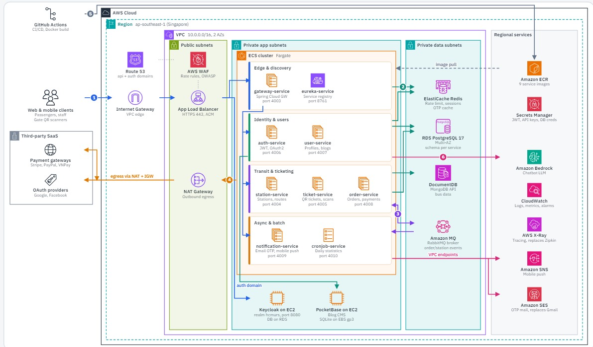

# Metro Backend: Microservices on AWS ECS Fargate

[](infra/)
[](docs/aws-deployment.md)
[](.github/workflows/)
[](https://openjdk.org/projects/jdk/21/)
[](https://spring.io/projects/spring-boot)

A 9-service Spring Boot backend for a metro ticketing system, deployed to AWS with Terraform, GitHub Actions and ECS Fargate. The infrastructure is fully reproducible from an empty account, deploys without stored AWS keys, and can be scaled to zero between uses.

- **Live:** `https://metro-fe.vercel.app/` (may be scaled down to save cost)
## Highlights

| Area | What was built |
|---|---|
| Infrastructure as Code | Terraform with 10 reusable modules, remote S3 state with native locking, `tflint`, and `fmt`/`validate`/`plan` on every PR |
| Compute | ECS Fargate cluster with 11 services; stateless services on Fargate Spot, gateway and Eureka on-demand |
| Networking | VPC across 2 AZs with public, private-app and private-data subnets; ALB with ACM TLS; fck-nat instead of NAT Gateway |
| CI/CD | Per-service GitHub Actions pipelines triggered by path filters; build, push to ECR, Trivy scan, rolling deploy |
| Security | GitHub OIDC with least-privilege roles (no access keys), SSM SecureStrings with write-only Terraform arguments (no secrets in state), RDS in subnets without internet access |
| Reliability | ECS deployment circuit breaker with automatic rollback, ALB and container health checks, Cloud Map service discovery |
| Observability | CloudWatch alarms on ALB 5xx, target health and RDS, routed to SNS email; centralized CloudWatch Logs |
| Cost control | AWS Budget alerts at $50 and $100; `scale` scripts take the stack from about $120 to about $35 per month |

### Target architecture



The diagram above shows the planned production design in `ap-southeast-1`. It differs from the current deployment in these ways:

- **Edge:** Route 53 and AWS WAF (rate rules, OWASP) in front of the ALB.
- **Managed data services:** ElastiCache Redis, DocumentDB and Amazon MQ (RabbitMQ) replace the self-hosted Redis and RabbitMQ containers and MongoDB Atlas. RDS PostgreSQL 17 moves to Multi-AZ.
- **Egress:** a managed NAT Gateway for third-party traffic (payment gateways, OAuth providers). VPC endpoints carry traffic to regional AWS services.
- **Supporting apps on EC2:** Keycloak for the auth domain and PocketBase for the blog CMS.
- **AWS integrations:** Amazon Bedrock for the chatbot, X-Ray for tracing (replaces Zipkin), SNS for mobile push, and SES for OTP mail (replaces Gmail).

## Technology

- **Cloud:** AWS (ECS Fargate and Fargate Spot, ECR, ALB, RDS PostgreSQL, Cloud Map, SSM Parameter Store, Secrets Manager, CloudWatch, SNS, Budgets, IAM OIDC, ACM)
- **IaC:** Terraform 1.16, AWS provider 6.x, tflint
- **CI/CD:** GitHub Actions with reusable workflows, Docker Buildx, Trivy, SonarCloud
- **Application:** Java 21, Spring Boot 3.4, Spring Cloud Gateway, Eureka, OpenFeign, PostgreSQL, MongoDB, Redis, RabbitMQ
- **Local:** Docker Compose

## Repository layout

```
infra/
  bootstrap/            S3 state bucket (applied once)
  envs/prod/            Root module: wires the modules together
  modules/              network, ecr, rds, ssm-secrets, ecs-cluster, ecs-service,
                        alb, github-oidc, monitoring, db-init
.github/workflows/      <service>-ci.yml, <service>-cd.yml, reusable workflows, infra-ci.yml
scripts/                push-ecr, db-init and scale (PowerShell and Bash versions)
services/               9 Spring Boot services
docs/aws-deployment.md  Operations runbook
http/                   HTTP request files, including aws-smoke.http
```

## CI/CD

| Workflow | Trigger | Steps |
|---|---|---|
| `<service>-ci.yml` | Pull request touching that service | Format check, unit tests, test report, SonarCloud |
| `<service>-cd.yml` | Push to `main-deployment` touching that service | Assume deploy role via OIDC, build `linux/amd64`, push `metro/<svc>:<sha>` to ECR, Trivy scan, register task definition, update service, wait for stability, fail if the circuit breaker rolled back |
| `infra-ci.yml` | Pull request touching `infra/**` | `terraform fmt -check`, `validate`, read-only `plan` through a separate OIDC role |

Only the changed service is built and deployed. The CD role can push only to `metro/*` repositories and update only the application services.

## Deploying

Prerequisites: Terraform 1.16, AWS CLI v2, Docker with Buildx.

```powershell
terraform -chdir=infra/bootstrap init; terraform -chdir=infra/bootstrap apply
terraform -chdir=infra/envs/prod init -backend-config=backend.hcl
terraform -chdir=infra/envs/prod apply -target="module.ecr"
./scripts/push-ecr.ps1
terraform -chdir=infra/envs/prod apply
./scripts/db-init.ps1
```

The full procedure, including DNS, secrets, rollback and teardown order, is in the [runbook](docs/aws-deployment.md).

## Operating

```powershell
./scripts/scale.ps1 status   # service counts, RDS state, alarm states
./scripts/scale.ps1 down     # silence alarms, scale ECS to 0, stop RDS
./scripts/scale.ps1 up       # start RDS, start services in dependency order, verify health
```

Bash equivalents (`scripts/*.sh`) work in Git Bash or WSL.

## Cost

| State | Approx. monthly (us-east-1) |
|---|---|
| Running | $110–130 |
| Scaled to zero | about $35 (ALB, fck-nat, storage) |

Main savings: fck-nat instead of a managed NAT Gateway (about $25 less per month), Fargate Spot for stateless services, and a single small RDS instance hosting six logical databases.

## Design decisions

- **fck-nat over NAT Gateway:** about one tenth of the cost. Runs in an Auto Scaling group of one that keeps the same ENI and Elastic IP, so egress recovers on its own and the Atlas allow-list never changes.
- **Eureka plus Cloud Map:** the application already relied on Eureka, so it stayed and no code changed. Cloud Map provides the stable DNS names that Eureka and the platform services need.
- **Fargate Spot for stateless services only:** the gateway and Eureka are single points of entry and run on-demand. Everything else tolerates a 2-minute reclaim.
- **OIDC instead of access keys:** short-lived credentials bound to the repository's immutable subject and the deployment branch. Nothing long-lived is stored in GitHub.
- **Secrets outside Terraform state:** generated values use write-only arguments, and the RDS master password is managed by RDS in Secrets Manager.

## Running locally

```bash
cp .env.sample .env          # fill in values
docker compose up -d
```

To run the same configuration the services use on AWS (PostgreSQL, Redis and RabbitMQ in containers), use `docker-compose.aws-local.yml` with `.env.aws-local.sample`.

Tests: `mvn test`
